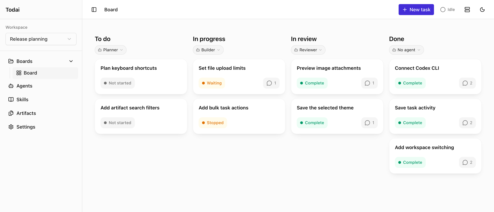

<div align="center">

# Todai

### Your tasks. Your agents. Your machine.

A local task board for AI agents.<br>
Build a repeatable workflow from planning through review.

**Codex CLI & Claude Code · Custom agents · Usage tracking · Workspace memory**

[Explore the features](#built-for-agent-work) · [Try Todai](#try-todai)

</div>



## Built for agent work

- **Your agents, your rules.** Choose roles, instructions, models, effort levels, and permissions.
- **A purpose for every column.** Assign agents and define the work required at each stage.
- **Visible credit usage.** Track Codex tokens and estimated credits by task, model, and activity.
- **Memory that adapts.** Use a completion column to capture project knowledge automatically for agents to reuse.

## From task to result

- **Automate at your pace.** Run tasks manually or automate execution and movement between stages.
- **Keep task changes separate.** Run agents in managed Git worktrees, with a separate branch for each task.
- **Keep the discussion close.** Mention agents in comments, use task chat, and inspect task history.
- **Keep the output.** Attach documents, images, and files to the work.

## Make it your workspace

- **Organize multiple projects.** Use separate workspaces, boards, and workflows.
- **Edit local skills.** Browse agent skills and edit workspace or Todai skill instructions.
- **Reuse your setup.** Import and export agent and board configurations.
- **Store data locally.** Keep board data on your machine while agents connect to your AI provider.

---

## Try Todai

Requires **Node.js 24+**, **macOS or Linux**, and a signed-in **Codex CLI** or **Claude Code** installation.

```sh
git clone https://github.com/RodRitter/todai.git
cd todai
npm ci
npm run dev
```

Open **[Todai →](http://127.0.0.1:3000)**, connect a project folder, and give your first agent a task.
